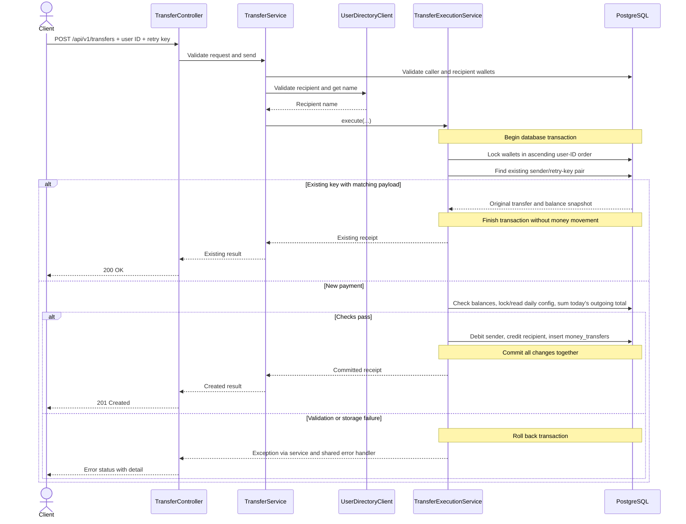

## Send-money sequence diagram

Input and external validation failures stop before the transactional execution.
The successful path and retries are shown below; runtime/storage failures inside
execution roll back all financial changes.

A reused key with a different payload also rolls back and returns 409.
